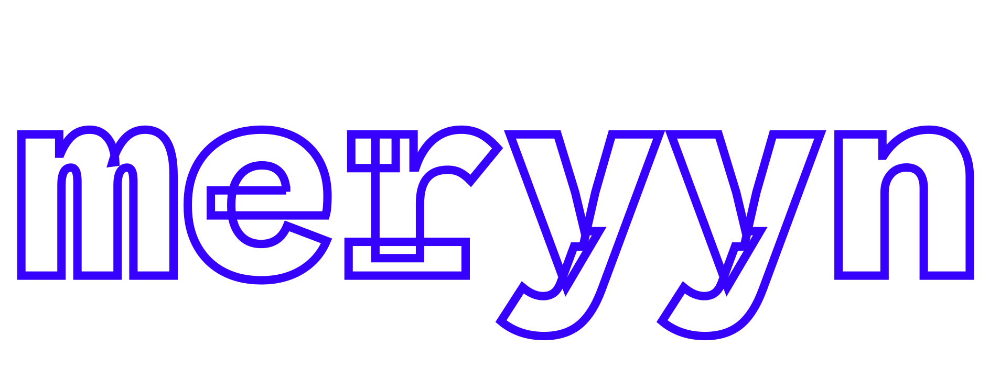
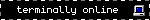

<div align="center">


**[rpm-ostree](https://coreos.github.io/rpm-ostree)/[bootc](https://bootc.dev) system with [cinnamon](https://github.com/linuxmint/cinnamon)**

[](https://www.media.mit.edu/publications/your-brain-on-chatgpt)
[](https://www.rainbowrailroad.org)
</div>

<br>

ALPHA PROJECT, ABSOLUTELY DOES NOT WORK PLEASE DON'T USE SERIOUSLY IT WILL BREAK IN 5 MINUTES PROBABLY

`Meryyn` is an atomic/immutable Linux distro based on [Fedora](https://fedoraproject.org). My main priorities are to make it as stable and reliable as possible, while having more private default settings than mainline Fedora and including the [Cinnamon](https://github.com/linuxmint/cinnamon) desktop.

<br>

### Installation

You can rebase from an existing ostree/bootc system:

```
curl https://github.com/CalamityFox/Meryyn/raw/refs/heads/main/meryyn-helper.sh
chmod +x helper.sh
meryyn-helper.sh
```
<br>

### Build process

All of `Meryyn`'s code is kept in the [**build.yml**](.github/workflows/build.yml). It pulls [fedora-bootc:latest](https://quay.io/fedora/fedora-bootc) and modifies it according to the meryyn-config, rechunks it with [Chunkah](https://github.com/coreos/chunkah), and signs it with [Cosign](https://github.com/sigstore/cosign) before uploading it to GitHub's [Container Registry](https://github.blog/news-insights/product-news/introducing-github-container-registry).

<br>

### Managing software

I pre-install a few applications like the [LibreWolf](https://librewolf.net) browser, [Thunderbird](https://thunderbird.net) e-mail client, and several [GNOME Core/Circle](https://apps.gnome.org) apps. For a full list of all software included in `Meryyn`, check the [**build.yml**](.github/workflows/build.yml).

All GUI apps are installed as Flatpaks and can be removed. Only the display manager, window manager, and shell, are part of the base image and cannot be removed without sacrificing system stability. Some CLI tools like [age](https://github.com/FiloSottile/age) and [yt-dlp](https://github.com/yt-dlp/yt-dlp) are planned to be installed with [toolbx](https://containertoolbx.org).

Additional software can be installed with [Bazaar](https://apps.gnome.org/Bazaar). If a package isn't available as a [Flatpak](https://flathub.org), you can [layer](https://docs.fedoraproject.org/en-US/atomic-desktops/getting-started/#package-layering) RPMs or use [toolbx](https://containertoolbx.org).

<br>

### Installation

You can rebase from a fresh [Silverblue](silverblue.fedoraproject.org) or other ostree/bootc system:

```
curl https://github.com/CalamityFox/Meryyn/raw/refs/heads/main/meryyn-helper.sh
chmod +x helper.sh
meryyn-helper.sh
```


<div align="center">

[*calamityfox@purelymail.com*](mailto:calamityfox@purelymail.com) ([**age**](misc/keys/public-key.age), [**gpg**](misc/keys/public-key.gpg))

#




 

</div>
