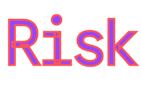

<div align="center">



</div>

#  What is this?

**Risk** is an [`rpm-ostree`](https://coreos.github.io/rpm-ostree)/[`bootc`](https://bootc.dev) system based on [Universal Blue](https://universal-blue.org). I've always had some issue with various pre-existing distros, so I'm making one for myself. If it ends up working well I might consider making it a "proper" distro, but for now this is purely a personal project.

It uses [`niri`](https://github.com/niri-wm/niri) with [`noctalia`](https://noctalia.dev/shell).

#  How it works

All of **Risk**'s customisations are kept within the [`Containerfile`](Containerfile) and the [`/sysfiles`](sysfiles) directory.

The `Containerfile` obtains the latest [Silverblue](https://fedoraproject.org/atomic-desktops/silverblue) image and modifies it according to the options laid out in the `Containerfile`.

[`/sysfiles/*`](sysfiles) is copied to `/` on the **Risk** system
.
**Risk** comes with various pre-installed applications. All but `niri`, `noctalia` and `sddm` can be removed, either through [Bazaar](https://apps.gnome.org/Bazaar) or with `flatpak remove $PACKAGE`. Additional software can be installed via [Flathub](https://flathub.org). If a package isn't available as a Flatpak, you can layer the RPM with `rpm-ostree install $PACKAGE && systemctl reboot` or through [`distrobox`](https://distrobox.it).

#  Installation

### Rebasing

```
# Pin current deployment
sudo ostree admin pin 0

# Rebase with rpm-ostree:
rpm-ostree rebase ostree-unverified-registry:ghcr.io/calamityfox/risk

# OR rebase with bootc:
sudo bootc switch --enforce-container-sigpolicy ghcr.io/calamityfox/risk:latest
```

### Fresh install
ISO builds will happen... at some point. Right now I'm working on other things first

#  Contact

If you encounter a bug, please report it in the [Issue Tracker](issues).

For anything else, message me on [Signal](https://signal.org), my username is  [`kes.123`](https://signal.me/#eu/nM5aRSJ1kqOL0RtXQHOtgxqk6S5baJuLUNf4RxV1cu1ZIYaKd_dNBIZPvKpvRRZO) 

# 

<div align="center">
   

  
</div>
